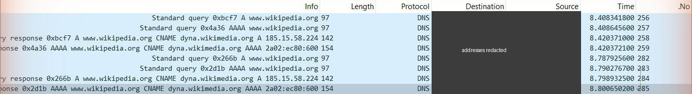
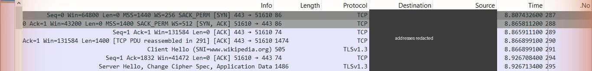

# Lab 01 — Network Traffic Analysis with Wireshark

**Goal:** Capture live traffic on a Windows host and analyze DNS resolution, the TCP three-way handshake, and the start of a TLS 1.3 session.

**Tools:** Wireshark 4.6, Windows 11, Wi-Fi interface

> Source/destination addresses are redacted in the screenshots for privacy.

---

## Part 1 — DNS Query and Response

**Steps**
1. Started a capture on the Wi-Fi interface.
2. Browsed to `www.wikipedia.org` to generate DNS traffic.
3. Applied the display filter: `dns.qry.name contains "wikipedia"`



**Findings**
- The client sent two queries for each lookup: **A** (IPv4) and **AAAA** (IPv6).
- The response shows `www.wikipedia.org` is a **CNAME** (alias) for `dyna.wikimedia.org`.
- The A record resolved to `185.15.58.224`; the AAAA record resolved to an IPv6 address in `2a02:ec80:600::/48`.
- The transaction ID (e.g. `0xbcf7`) links each response to its query.

## Part 2 — TCP Three-Way Handshake and TLS

**Steps**
1. Applied `tcp.flags.syn==1` to locate the connection setup.
2. Followed the connection with `tcp.port==51610`.



**Findings**

| Packet | Flags | Meaning |
|---|---|---|
| 287 | `SYN` | Client requests a connection (Seq=0) |
| 288 | `SYN, ACK` | Server accepts and acknowledges (Ack=1) |
| 289 | `ACK` | Client confirms — connection established |
| 291 | TLS `Client Hello` | Encryption negotiation begins (TLS 1.3) |
| 295 | TLS `Server Hello` | Server answers; traffic is encrypted from here |

- Even though the session is encrypted, the **SNI** field in the Client Hello reveals the destination hostname (`www.wikipedia.org`). This is useful for detecting suspicious domains in a SOC.
- Round-trip time from SYN to SYN-ACK was about **58 ms**.

## Part 3 — DHCP DORA

_Coming soon:_ capture `ipconfig /release` and `ipconfig /renew` to show Discover, Offer, Request, and Acknowledge.

---

## What I Learned
- A single page load triggers both A and AAAA lookups, and the browser may connect over **IPv6** even when an IPv4 address is returned. My first filter on the IPv4 address returned nothing for this reason.
- How to narrow thousands of packets down to one conversation using display filters.
- What an analyst can still see in encrypted traffic: DNS queries, SNI, timing, and packet sizes.
- The order of the TCP handshake and where TLS negotiation starts.

## Useful Filters
```
dns
dns.qry.name contains "example"
tcp.flags.syn==1
tcp.flags.syn==1 && tcp.flags.ack==1
tcp.port==443
tls.handshake.type==1
```
